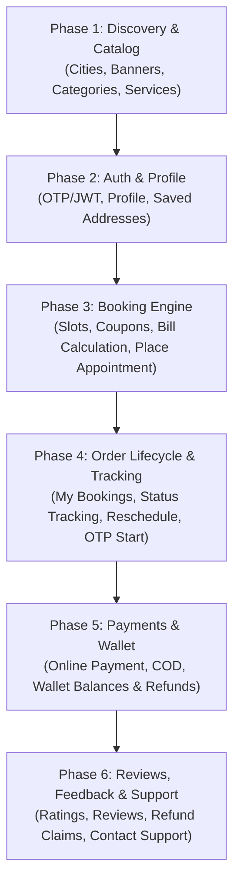

# 🌸 Nova Beauty – User (Customer) API Roadmap & Specification

> **Platform:** Nova Beauty (Home Salon & Doorstep Beauty Services)  
> **Target Audience:** End Customers (Web / Mobile App)  
> **Database:** MySQL (`u760758253_nova_beauty`)  
> **Backend Stack:** Node.js, Express.js (ES Modules), `mysql2/promise`, JWT Authentication

---

## 📌 Phase-Wise Implementation Roadmap



---

## 🚀 Detailed Phase-Wise APIs

### 🔹 Phase 1: Discovery & Public Catalog (No Login Required)
Homepage ([`index.html`](https://novabeauty.org.in/NOVA_BEAUTY/Source/HTML/index.html)) aur services browse karne ke liye public APIs:

| Method | Endpoint | Description | DB Table | Auth Required |
| :--- | :--- | :--- | :--- | :--- |
| `GET` | `/api/v1/cities` | List of operational cities (e.g., Delhi, Noida, Lucknow) | `cities` | ❌ No |
| `GET` | `/api/v1/banners` | Promotional hero banners and sliders (filter by `city`) | `banners`, `city_banners` | ❌ No |
| `GET` | `/api/v1/categories` | Service categories (Hair, Facial, Waxing, Makeup) | `categories` | ❌ No |
| `GET` | `/api/v1/services` | Services list (filtered by `category` and `city`) | `services`, `service_city_prices` | ❌ No |
| `GET` | `/api/v1/services/:id` | Detailed single service view (price, duration, about, included) | `services` | ❌ No |
| `GET` | `/api/v1/services/search` | Search services by query string `?q=facial` | `services` | ❌ No |
| `GET` | `/api/v1/testimonials` | Customer reviews & ratings for social proof | `appointments` (`rating > 3`) | ❌ No |

---

### 🔹 Phase 2: Customer Authentication, Profile & Addresses
User account management and doorstep delivery addresses:

| Method | Endpoint | Description | DB Table | Auth Required |
| :--- | :--- | :--- | :--- | :--- |
| `POST` | `/api/v1/auth/send-otp` | Send 6-digit OTP on customer mobile number | `users` / SMS Gateway | ❌ No |
| `POST` | `/api/v1/auth/verify-otp` | Verify OTP and return JWT auth token + user data | `users` | ❌ No |
| `POST` | `/api/v1/auth/login` | Email/Password login (fallback / alternative) | `users` | ❌ No |
| `GET` | `/api/v1/user/profile` | Get logged-in user profile, wallet balance, referral code | `users` | 🔒 Yes (Customer) |
| `PUT` | `/api/v1/user/profile` | Update profile (name, email, city, profile_pic) | `users` | 🔒 Yes (Customer) |
| `GET` | `/api/v1/user/addresses` | Get list of user saved addresses (Home, Work, etc.) | `addresses` | 🔒 Yes (Customer) |
| `POST` | `/api/v1/user/addresses` | Add new doorstep address (address, landmark, lat, lng, city) | `addresses` | 🔒 Yes (Customer) |
| `PUT` | `/api/v1/user/addresses/:id` | Edit an existing address | `addresses` | 🔒 Yes (Customer) |
| `DELETE` | `/api/v1/user/addresses/:id` | Remove a saved address | `addresses` | 🔒 Yes (Customer) |

---

### 🔹 Phase 3: Booking Engine & Checkout Flow
Service scheduling, coupon validation, and appointment creation:

| Method | Endpoint | Description | DB Table | Auth Required |
| :--- | :--- | :--- | :--- | :--- |
| `GET` | `/api/v1/bookings/available-slots` | Check available slots for a date & city (e.g. 10:00 AM) | `appointments` | 🔒 Yes |
| `POST` | `/api/v1/coupons/apply` | Validate coupon code, check min order, return discount | `vendor_coupons` | 🔒 Yes |
| `POST` | `/api/v1/bookings/calculate-bill` | Preview bill breakdown: Subtotal + GST + City extra - Coupon | In-memory / Config | 🔒 Yes |
| `POST` | `/api/v1/appointments` | Create new appointment / booking | `appointments`, `order_items` | 🔒 Yes |

#### Sample Request: `POST /api/v1/appointments`
```json
{
  "address_id": 12,
  "booking_date": "2026-11-15",
  "booking_time": "11:00:00",
  "services": [
    { "service_id": 4, "quantity": 1 },
    { "service_id": 8, "quantity": 1 }
  ],
  "coupon_code": "NOVA100",
  "payment_method": "cod" // or "online", "wallet"
}
```

---

### 🔹 Phase 4: Appointment Management & Live Tracking
Appointment status tracking, rescheduling, and service OTP:

| Method | Endpoint | Description | DB Table | Auth Required |
| :--- | :--- | :--- | :--- | :--- |
| `GET` | `/api/v1/appointments` | Get user's appointments (`status`: upcoming, completed, cancelled) | `appointments` | 🔒 Yes |
| `GET` | `/api/v1/appointments/:bookingId`| Get full details of a specific booking (Beautician info, OTP, bill) | `appointments`, `users` | 🔒 Yes |
| `POST` | `/api/v1/appointments/:bookingId/reschedule` | Change appointment date & time | `appointments` | 🔒 Yes |
| `POST` | `/api/v1/appointments/:bookingId/cancel` | Cancel booking (records cancellation reason) | `appointments` | 🔒 Yes |
| `GET` | `/api/v1/appointments/:bookingId/track` | Live beautician status (Assigned ➔ On the way ➔ Arrived ➔ In-progress) | `appointments`, `users` | 🔒 Yes |

> **Security Note:** Service start hone par beautician customer se **OTP** mangti hai jo `appointments.otp` me match hota hai, ensuring safety.

---

### 🔹 Phase 5: Payments, Wallet & Refunds
Financial transactions, gateway orders, and wallet balance:

| Method | Endpoint | Description | DB Table | Auth Required |
| :--- | :--- | :--- | :--- | :--- |
| `POST` | `/api/v1/payments/create-order` | Create Razorpay/Cashfree online order id | `payments` | 🔒 Yes |
| `POST` | `/api/v1/payments/verify` | Verify payment webhook / signature and update appointment | `payments`, `appointments` | 🔒 Yes |
| `GET` | `/api/v1/wallet/transactions` | Customer wallet credit/debit passbook history | `wallet_transactions` | 🔒 Yes |
| `POST` | `/api/v1/refunds/request` | Raise a refund claim for bad service, no-show, or double charge | `refund_requests` | 🔒 Yes |

---

### 🔹 Phase 6: Post-Service, Feedback & Support
Customer satisfaction and support inquiries:

| Method | Endpoint | Description | DB Table | Auth Required |
| :--- | :--- | :--- | :--- | :--- |
| `POST` | `/api/v1/appointments/:bookingId/rate` | Submit rating (1 to 5 stars) and review text | `appointments` (`rating`, `review_text`) | 🔒 Yes |
| `GET` | `/api/v1/notifications` | In-app alerts (booking confirmation, beautician on the way) | `notifications` | 🔒 Yes |
| `PUT` | `/api/v1/notifications/:id/read`| Mark notification as read | `notifications` | 🔒 Yes |
| `POST` | `/api/v1/contact-us` | Contact/Inquiry message submission | Email / DB log | ❌ No |

---

## 🗄️ Database Tables Quick Reference

| Table Name | Primary Purpose for Customer |
| :--- | :--- |
| `cities` | Operational coverage zones |
| `banners` | Promotional marketing sliders |
| `categories` | Service classification (Waxing, Facial, etc.) |
| `services` | Salon services, pricing, durations, offers |
| `users` | Customers, beauticians, vendors, wallets |
| `addresses` | Customer doorstep locations (Lat/Lng, Landmarks) |
| `appointments` | Core booking records, status, OTP, subtotal, GST |
| `vendor_coupons` | Discounts, min order limit, expiration |
| `wallet_transactions` | Customer cashbacks, referral credits, debits |
| `refund_requests` | Dispute handling and refund approvals |
| `notifications` | User FCM push and in-app notifications |

